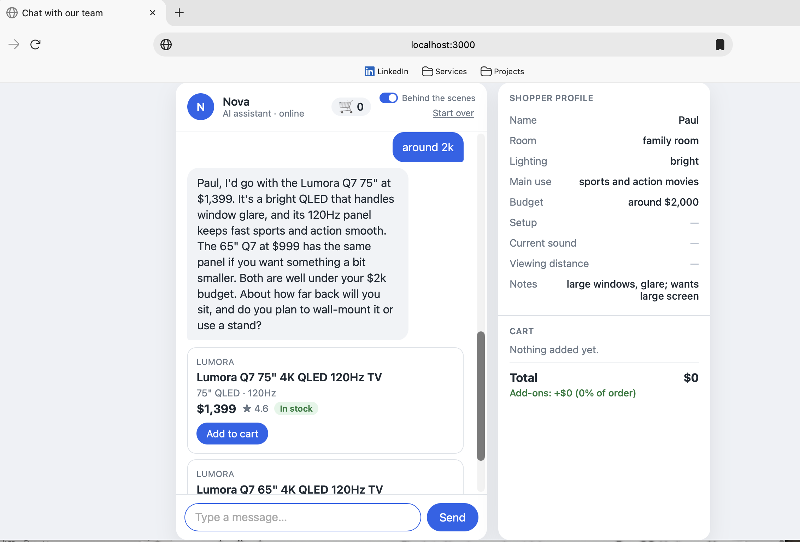
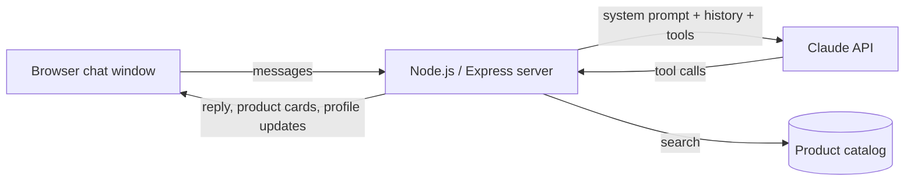

# chat-agent
# AI Web Messaging Agents — Lead Gen & Guided Selling Demo

A working prototype of AI agents in a web messaging window, built to show how
conversational AI turns website visitors into qualified leads and higher-value orders.




## What it demonstrates

- **Front-door routing** — asks the visitor's name, then routes commercial buyers and
  consumers to the right agent. The agent greets them by name and uses it naturally.
- **B2B lead qualification (Zoltan)** — an SDR agent that qualifies bulk electronics buyers
  on company, role, need and timeline, then offers to book a meeting with an account executive.
- **Guided selling (Nova)** — a consumer product advisor that asks about room, viewing,
  budget and setup, then recommends TVs from a real product catalog via tool use.
  It never invents products, prices or stock.
- **Contextual cross-sell** — suggests only the add-ons that fit (soundbar, wall mount,
  HDMI cable, streaming device) based on what the shopper said.
- **Live "behind the scenes" panel** — shows the shopper profile filling in as the
  conversation happens, plus the cart and add-on revenue as a share of the order.

## How it works



Each agent is a plain-English prompt file. Products live in a separate data file.
The server handles the API calls and tools. That separation means:

- Conversation designers can create or tune agents without touching code.
- Swapping the catalog and prompt re-targets the demo to a new brand or vertical.
- The API key stays on the server and out of source control.

## Project structure

```
agents/          Agent prompts (one file per agent)
data/            Sample product catalog (fictional brands)
public/          Chat window UI
server.js        Server, Claude API calls, tool handling
```

## How I built it

I designed the agents, conversation flows and cross-sell logic, drawing on 10 years
of designing customer journeys for enterprise messaging. I directed the build with
**Claude Code** and ran repeated QA passes to tune agent behavior.

**Stack:** Node.js, Express, Anthropic Claude API (tool use), vanilla HTML/CSS/JS

## Run it locally

1. Clone the repo and run `npm install`
2. Copy `.env.example` to `.env` and add your Anthropic API key
3. Run `npm start` and open http://localhost:3000

## Roadmap

- HubSpot CRM integration: create contacts and deals, book meetings
- Agent-to-agent handoff with conversation context
- Voice channel version of the lead-gen agent

*All brands, products and prices are fictional sample data.*
